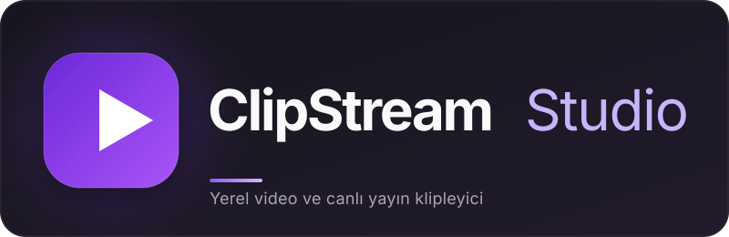
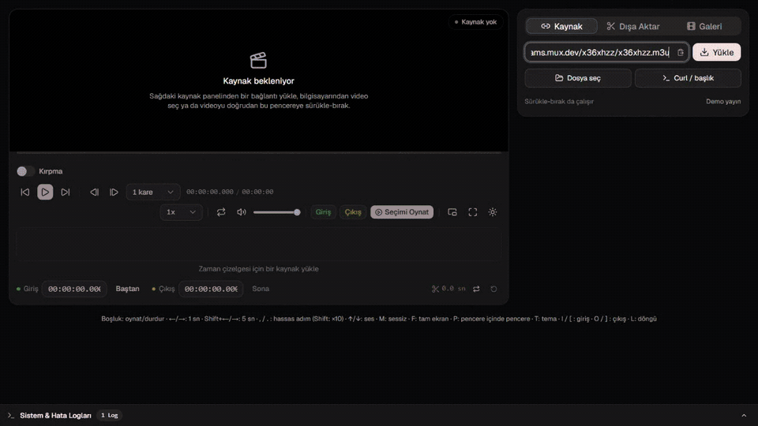

<p align="center">
  
</p>

<p align="center">
  Bilgisayarında çalışan video ve canlı yayın klipleyici.<br />
  Bağlantıyı yapıştır, istediğin bölümü kes, kırp ve dışa aktar.
</p>

<p align="center">
  
  
  
  
  
</p>

<p align="center">
  <a href="docs/demo.mp4">
    
  </a>
</p>

<p align="center">
  <sub>Demo kaynağı: Mux HLS test akışı · <a href="docs/demo.mp4">MP4 olarak izle</a></sub>
</p>

---

## Özellikler

- **Kaynaklar:** MP4/WebM, HLS (`.m3u8`), YouTube, X ve Instagram.
- **Kesme:** Zaman çizelgesinden giriş/çıkış; noktalar birbirini geçerse otomatik yer değiştirir.
- **Kırpma:** Video üzerinde sürükle-boyutlandır; 16:9, 9:16, 1:1, 4:5 ve serbest oranlar.
- **Dışa aktarma:** MP4 (hızlı/hassas), GIF ve MP3; canlı ilerleme ve iptal.
- **GPU render:** Uyumlu NVIDIA/Intel/AMD H.264 kodlayıcılarında isteğe bağlı GPU dışa aktarma; GPU yoksa veya hata verirse CPU'ya otomatik dönüş.
- **Galeri:** Klipleri modalda oynat, indir, klasörde göster veya sil.
- **Yerel dosyalar:** Gözat veya sürükle-bırak. Açık proje varken bırakılan video yeni sekmede açılır.
- **Korumalı bağlantılar:** `curl` komutunu yapıştırarak referer/cookie başlıkları ekle.
- **Dil:** İngilizce ve Türkçe arayüz; İngilizce varsayılan, Türkçe tarayıcılarda otomatik seçilir. Alt bilgideki dil seçiciyle sayfa yenilenmeden değiştirilir; API hata mesajları da seçilen dilde döner.
- **Kısayollar:** `Boşluk`, `I`/`O`, `←`/`→`, `M`, `F`, `P`.

## Hızlı Başlangıç

**Gereksinimler**

- Windows 10/11
- Python 3.10+
- FFmpeg (`ffmpeg` ve `ffprobe` PATH'te olmalı)
- Node.js 20+ — yalnızca arayüz ilk kez derlenecekse
- yt-dlp — YouTube, X ve Instagram için opsiyonel

**Çalıştırma**

```bat
pip install -r requirements.txt
baslat.bat
```

`baslat.bat` sunucuyu başlatır ve tarayıcıda `http://127.0.0.1:8765` adresini açar. Arayüz derlemesi yoksa gerekli npm paketlerini kurup derler.

YouTube, X ve Instagram kaynakları için `yt-dlp` gerekir: `pip install -U yt-dlp`.

Kapatmak için `durdur.bat` dosyasını çalıştır.

## Kullanım

1. **Kaynak:** Bağlantıyı yapıştır veya videoyu pencereye sürükle.
2. **Kes:** Zaman çizelgesinde giriş/çıkış noktalarını ayarla.
3. **Kırp (isteğe bağlı):** Kırpma anahtarını açıp videoda alan seç.
4. **Dışa Aktar:** Formatı ve kesim modunu seç; uyumlu MP4 dışa aktarmalarında **GPU ile render** anahtarını açabilirsin.
5. **Galeri:** Oluşan klibi ▶ düğmesiyle modalda izle.

Klipler `exports/` klasörüne kaydedilir. Sürükle-bırak ile eklenen geçici dosyalar `cache/uploads/` altında tutulur ve 7 gün sonra temizlenir.

### GPU ile render

- Yalnızca **MP4** ve **hassas kesim** veya **kırpma** dışa aktarmalarında kullanılabilir; hızlı kopyalama yeniden kodlama yapmadığı için GPU'yu kullanamaz.
- FFmpeg derlemesinde `h264_nvenc` (NVIDIA), `h264_qsv` (Intel) veya `h264_amf` (AMD) bulunmalı; sürücü ve donanım çalışır olmalı.
- Uygulama kısa bir test kodlamasıyla gerçek yeteneği doğrular. Kodlayıcı yoksa anahtar kapalıdır ve nedeni panelde gösterilir.
- GPU sürücü/oturum hatası verirse iş otomatik olarak CPU ile yeniden denenir; sonuç kartında bilgi görünür.
- GPU çıktısı CPU ile birebir aynı değildir; kalite ve dosya boyutu farklı olabilir.

## Sorun Giderme

- **FFmpeg bulunamadı:** `ffmpeg` ve `ffprobe` PATH'te olmalı. Kurulumdan sonra terminali yeniden aç.
- **YouTube/X/Instagram açılmıyor:** `pip install -U yt-dlp` ile güncelle.
- **8765 portu kullanımda:** Çalışan sunucuyu `durdur.bat` ile kapat.
- **HLS oynamıyor:** Bu sürüm `.m3u8` adreslerini destekler; `.txt` master playlist'leri desteklenmez.
- **Korumalı medya:** Kaynak panelindeki **Gelişmiş bağlantı** ile `curl` komutunu referer/cookie başlıklarıyla birlikte yapıştır.

## Geliştirme

```bat
scripts\dev.bat
```

Backend `http://127.0.0.1:8765`, arayüz `http://127.0.0.1:5173` adresinde çalışır. Üretim sunucusu açıksa önce `durdur.bat` ile kapat.

Arayüzü elle derlemek için:

```bat
cd frontend
npm run build
```

Backend komut ve GPU seçim testleri:

```bat
python -m unittest discover -s backend/tests -v
```

---

<p align="center">
  <sub>Yerel çalışır. Kliplerin bilgisayarından ayrılmaz.</sub>
</p>
