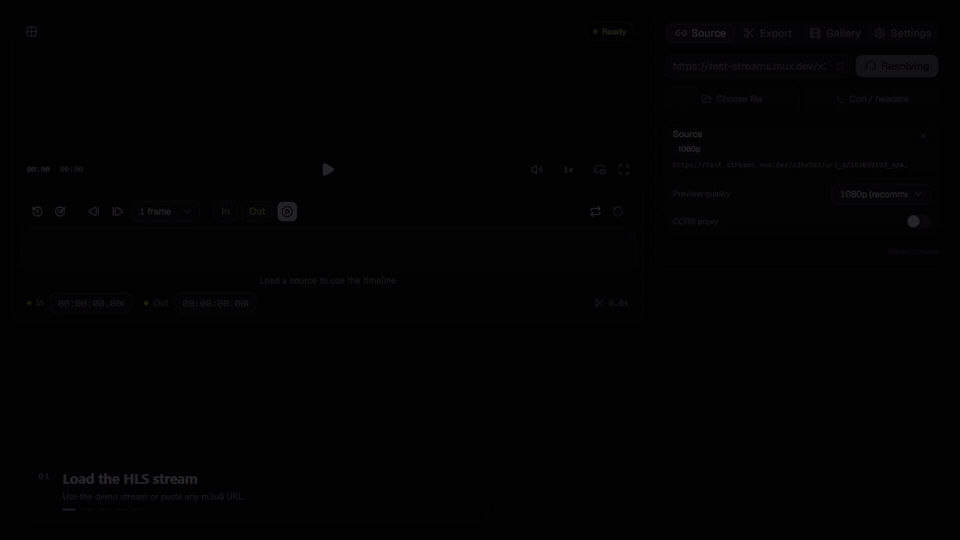

<p align="center">
  <picture>
    <source media="(prefers-color-scheme: dark)" srcset="docs/logo/dark.svg">
    <source media="(prefers-color-scheme: light)" srcset="docs/logo/light.svg">
    
  </picture>
</p>

<p align="center">
  A local video and live stream clipper.<br />
  Paste a link. Trim, crop, and export.
</p>

<p align="center">
  
  
  
  
  
  
</p>

<p align="center">
  <a href="docs/demo-v2.mp4">
    
  </a>
</p>

<p align="center">
  <sub>Demo source: Mux HLS test stream · <a href="docs/demo-v2.mp4">Watch the MP4</a></sub>
</p>

---

## Supported Sources

<table>
  <tr>
    <td align="center" width="64"></td>
    <td><strong>YouTube</strong><br><sub>Videos and Shorts.</sub></td>
  </tr>
  <tr>
    <td align="center"></td>
    <td><strong>X (Twitter)</strong><br><sub>Video posts.</sub></td>
  </tr>
  <tr>
    <td align="center"></td>
    <td><strong>Instagram</strong><br><sub>Public posts and reels.</sub></td>
  </tr>
  <tr>
    <td align="center"></td>
    <td><strong>TikTok</strong><br><sub>Videos and Live streams (playback only).</sub></td>
  </tr>
  <tr>
    <td align="center"></td>
    <td><strong>m3u8 / HLS Stream</strong><br><sub>Master and media playlists. Supports <code>.m3u8</code>, <code>.txt</code>, and extensionless URLs.</sub></td>
  </tr>
  <tr>
    <td align="center"></td>
    <td><strong>Direct MP4 / WebM</strong><br><sub>HTTP(S) video files.</sub></td>
  </tr>
  <tr>
    <td align="center"></td>
    <td><strong>Local files</strong><br><sub>Browse or drag and drop.</sub></td>
  </tr>
</table>

> YouTube, X, Instagram, and TikTok need `yt-dlp`. HLS and direct files do not.
>
> <sub>Brand logos are from Simple Icons (CC0). HLS and local file icons are custom.</sub>

## Features

- **Sources:** YouTube, X, Instagram, TikTok, HLS, direct MP4/WebM, and local files.
- **Audio:** Choose alternate HLS audio tracks or YouTube dubs.
- **Subtitles:** Preview HLS WebVTT subtitles. Subtitles are not burned into exports.
- **HLS errors:** Clear messages for 403, 404, CORS, missing segments, and unsupported codecs.
- **Trim:** Set in and out points on the timeline.
- **Crop:** Use presets or freeform selection.
- **Export:** MP4, GIF, and MP3.
- **Export quality:** Original/fast, High, Balanced, and Compact profiles with estimated savings, plus optional H.265 and 30 fps for smaller files.
- **GPU export:** Optional. Falls back to CPU automatically.
- **Gallery:** Play, download, reveal, or delete clips.
- **Protected media:** Paste a `curl` command to add headers.
- **Languages:** English and Turkish.
- **Shortcuts:** `Space`, `I`/`O`, `←`/`→`, `M`, `F`, `P`.

## Quick Start

**Requirements**

- Windows 10/11
- Python 3.10+
- FFmpeg in `PATH`
- Node.js 20+ for the first UI build
- yt-dlp for YouTube, X, Instagram, and TikTok

**Run**

```bat
pip install -r requirements.txt
start.bat
```

`start.bat` starts the app at `http://127.0.0.1:8765`.

Install yt-dlp for social links:

```bat
pip install -U yt-dlp
```

Stop the app with `stop.bat`.

## Usage

1. Paste a link or drop a video.
2. Set the trim range.
3. Crop if needed.
4. Choose a format and export.
5. Open the clip in Gallery.

Clips are saved to `exports/`. Temporary uploads are removed after 7 days.

The address bar shows `#project/?v=<version>`. The version comes from `frontend/package.json`.

## Versioning

The app version follows `0.1.x`. Increment the last number by one for every
development change and keep `frontend/package.json`, `frontend/package-lock.json`,
and the version badge above in sync. Current version: `0.1.144`.

## Troubleshooting

- **FFmpeg not found:** Add `ffmpeg` and `ffprobe` to `PATH`. Reopen the terminal.
- **Social links fail:** Update yt-dlp.
- **HLS fails:** Read the error toast. Use Advanced link or enable the CORS proxy.
- **Port 8765 is busy:** Run `stop.bat` first.

## Development

```bat
scripts\dev.bat
```

Backend: `http://127.0.0.1:8765`

UI: `http://127.0.0.1:5173`

Build the UI:

```bat
cd frontend
npm run build
```

Run the backend tests:

```bat
python -m unittest discover -s backend/tests -v
```

## License

MIT. See [LICENSE](LICENSE).

---

<p align="center">
  <sub>Runs locally. Your clips stay on your computer.</sub>
</p>
